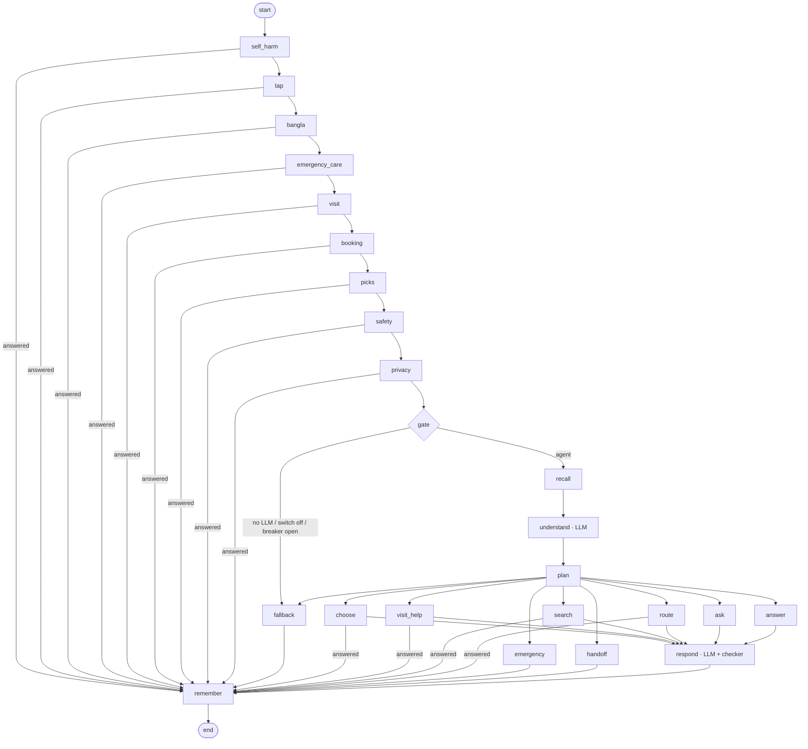

# Vita on LangGraph

`POST /v2/agent/chat` runs the whole conversation as one LangGraph graph (`hms_router/vita_graph/`). There is no other
conversation engine (since 2026-10-31: the old `/chat` triage agent `HMSRouterAgent` and Vita's rules engine are gone;
`POST /chat` is now only an alias of Vita). One graph run = one patient message; the conversation's state is saved per
session by a Redis checkpointer, so Vita remembers what was said, survives restarts, and every turn can be inspected.
Request and reply are unchanged (see [vita_doctor_search.md](vita_doctor_search.md)); replies carry `engine`:
`step` (a code step answered), `agent` (the LLM's checked reply), `agent+step` (the agent chose a step, e.g. choosing a
doctor or a handoff), `agent+template` (the LLM's reply was blocked: the tool's own wording), `fallback`.

| Node | What it does | Model? |
|---|---|---|
| `self_harm` | A person first, whatever was going on: Tele-MANAS 14416 and 108; any booking or pending step is dropped | code |
| `tap` | A doctor chosen from a list (`select_doctor_id`, a WhatsApp `doc:` row), the next page, the screen's filter chips | code |
| `bangla` | Bangla is recognised, not yet understood: said so in Bangla, Hindi and English, with the emergency number | code |
| `emergency_care` | After an emergency: nearest emergency-ready places for a shared location, sharing the number, "ambulance aa gayi", "ab theek hoon", "108 nahi lag raha"; otherwise the number is said once before the next reply | code |
| `visit` | After booking: the way to the clinic (app), the day of the visit (check-in, token, queue) | code |
| `booking` | Day, time, for whom, details, OTP, confirm; side questions ("number kyun chahiye?") answered and the question asked again; anything else ends the booking | code |
| `picks` | Answers to Vita's own last question: "where are you?", "which of these doctors / hospitals?", "pehla wala", a typed "haan" to "book?", "kal milenge?" about the doctor just chosen, "kya?" (the question again), "naya shuru karo" (a clean start) | code |
| `safety` | The shared emergency detector (rules + model, denial-aware) on every message; the warning-sign questions (burn, head injury, pregnancy + swelling) before anyone is sent to 108 | code |
| `privacy` | "Dr X ka number do": never a doctor's personal number; booking, or the hospital front desk from 1HMS | code |
| `gate` | The LLM agent answers only with an LLM, the control switch on `agent` and the breaker closed | code |
| `fallback` | Without the agent: a plain doctor search when the message is plainly one ("cardiologist", "dr neha sharma", "aur dikhao", "kam fees wala", "Kishanganj ke doctor"), "talk to a person", a hello; anything else: "please try again in a minute, or talk to our team; in an emergency call 108" (`degraded: ["understanding"]`) | code |
| `recall` | The returning patient's memory; the 3 most similar approved examples | code |
| `understand` | Reads the message in the light of the conversation → `record_understanding`: intent, complaint so far in English, enough to choose a doctor?, danger signs, who / age group / pregnant, language, doctor filters | **LLM** |
| `plan` | Danger signs → emergency (the LLM can only add urgency); a person → handoff; choose / book → choose; directions / check-in → visit_help; doctor filters → search; symptoms → route when enough (or after 2 questions), else ask; otherwise answer | code |
| `choose` | A doctor already shown, by name or "this one"; a doctor's day; booking again after choosing; nothing to choose yet → the LLM says so | code |
| `search` | `find_doctors`: the filters (a refinement alone — "kam fees", "lady doctor", "Patna mein" — narrows the last list); spelling-tolerant names, specialties and cities | code |
| `route` | `assess_symptoms`: emergency check on the LLM's reading + the patient's words, then the route-symptom engine (denials removed; age group, pregnancy; a child's GP becomes a Paediatrician), then doctors from 1HMS | code (engine) |
| `ask` / `answer` | Facts for one question (never one already answered) or a reply within Vita's role (with the chosen doctor's fee and hospital from 1HMS) | code |
| `respond` | Writes the reply in the patient's language from the decision, facts, memory and examples → `reply` (+ ≤3 tap options); `checker.py` blocks medicines/doses, diagnoses, phone numbers, links, booking claims, unknown doctors, >700 chars → the tool's own words or the fallback | **LLM** |
| `remember` | Appends the turn to the conversation, updates patient memory, writes the trace | code |

State that carries across turns: `messages`, `patient` (who, age group, pregnant, language), `triage` (complaint so
far, questions asked, routed), `stage`. Per-turn fields are reset at the start of each run. The code steps live in
`application/doctor_chat.py` (`step_*`, and the agent's code tools `read_ask`, `plain_search`, `choose`, `handoff`,
`facts`, `emergency_reply`, `unavailable`).

## The planner (mode "planner")

The `agent` path above has the model label each message with a fixed intent; code then picks the next move. With the
control switch on `"planner"` (all channels or one), the model plans instead (`vita_graph/planner.py`):

| Tool | |
|---|---|
| `note_needs` | One picture of what the patient needs, updated from anything they say, in any order: who, age group, pregnant, the complaint so far, danger signs, language, place / near me, day, time of day, budget, doctor gender, a specialty / doctor / degree / hospital they want, in a hurry. Kept per conversation (`need` in the graph state); "koi bhi chalega" removes a preference |
| `find_doctors` | Any mix of filters in one search; the needs fill what the model left out (a lady doctor, cheaper, the place, today) |
| `assess_symptoms` | The route-symptom engine on the complaint (emergency check first); says when the engine is unsure and gives its question ("child or adult?") |
| `doctor_days`, `choose_doctor`, `visit_help`, `talk_to_person` | When a doctor sits; a doctor on screen by name or position; the day of the visit; a handoff |
| `reply` | Vita's message (always last) |

Usually two model calls a message: [`note_needs` + a tool] then [`reply`]; at most 4. Code still decides what matters:
the safety steps run first; danger signs in `note_needs` end the turn with the emergency reply at once; a tool that
answers the patient itself (an emergency, a location question, a doctor chosen, a handoff) ends the turn in its own
words; every reply passes `checker.py`; after 3 questions without an answer the complaint is assessed instead of asked
about again; booking/OTP stay in the booking step. Replies carry `engine`: `planner`, `planner+step`,
`planner+template`, `fallback`. Tests: `tests/test_vita_planner.py`.

## Scenario suite against the real model

`python -m hms_router.vita_graph.evals --mode both --out evals.json` (in the router container, with the service's
settings) plays 37 scenarios through a private Vita with the real model, the real doctor directory and route-symptom:
safety (self-harm in three scripts and mid-conversation, chest pain, stroke, child breathing, pregnancy bleeding,
poisoning, minor burn, diagnosis / dose / phone-number bait), triage (fever, tooth, child, eye, periods, back, sugar,
vague complaints never to an alarming specialist), and flexibility (many needs in one message, cheaper after a list,
a change of mind, in a hurry, typos, degree, English, Hindi script). It prints agent vs planner side by side and every
failing reply. Without a model only the safety scenarios can pass (they do: `test_every_safety_scenario_passes_without_a_model`).

## How Vita grows

| Signal | Where |
|---|---|
| Every turn traced: redacted message, understanding, decision, tools, checker result, reply, specialist | `vita:trace:{sid}`, `vita:conv:{sid}`, 30 days |
| Outcomes: booked, emergency, 👍/👎 from the patient | `POST /v2/agent/feedback {session_id, rating: up|down, comment?}` |
| Staff review: list conversations by outcome, open one turn by turn (with the saved graph state) | `GET /v2/agent/admin/conversations?outcome=booked|emergency|up|down`, `GET /v2/agent/admin/conversations/{sid}` |
| Staff approve a good turn, or correct its reply and/or its specialist → a **draft** example | `POST /v2/agent/admin/examples {session_id, turn, reply?, specialist?, note?}` (or `{patient, reply, specialist}`) |
| Tested before live: the scenario suite (`evals.py`: safety, routing, language, medicine, off-topic) runs with and without the drafts; drafts go live only if every safety scenario passes and the score is not lower | `POST /v2/agent/admin/examples/promote`; `python -m hms_router.vita_graph.evals` |
| Recall: active examples most like the message are shown to the LLM as "how Vita answered similar patients" | `ExampleStore.similar` (TF-IDF, character n-grams) |
| Patient memory (identified patients only: WhatsApp's verified number or a signed-in patient's token; key = HMAC of the mobile): language and city always; who they book for, past specialties and doctors only with `remember: true` (patient consent); 180 days | `vita:patient:{hmac}`; forget: `DELETE /v2/agent/patient-memory {patient_token | verified_mobile}` |
| Specialty learning stays in the route-symptom model (CMS-approved examples + `retrain.yml`) | `/admin/rebuild` |

## Control

`GET/PUT /v2/agent/admin/control` (scope `admin`): `{"mode": "agent" | "planner" | "off", "channels": {"whatsapp": "planner"}}`
— a kill switch, per channel (`"rules"` is still accepted and read as `"off"`). With the agent off, without
`VITA_LLM_PROVIDER`, on any error, and for 60 s after 3 failures in a row, the code steps still run (safety, booking,
taps, after an emergency, the visit) and everything else gets the fallback. `GET /health` shows
`vita: {llm, model, mode, breakerOpen}`.

## The search bar

`POST /v2/agent/search-intent {query, city?, context?: {ageGroup}}` (scope `route`): one search-bar query read the same
way as a chat message, nothing stored → `{kind: symptom | specialty | name | degree | hospital | place | near |
emergency | none, specialtyId, specialtyIds (NexEagle ids), city (as 1HMS spells it, or "NEAR_ME"), doctorName (as
listed), degree, hospital, gender, availableToday, keywords, corrected, emergency {flag, reasons,
recommendedSpecialtyIds}, method, confidence, modelVersion}`, plus route-symptom's own `decision`, `decisive`,
`clarify`, `reason`, `usedDefault` for symptoms (so a `/route-symptom` caller reads it unchanged). Doctor Dekho's
`/api/search/parse` calls it first.

## Settings

`VITA_LLM_PROVIDER=groq` + `GROQ_API_KEY`, `VITA_LLM_MODEL` (default `openai/gpt-oss-120b`), `VITA_LLM_TIMEOUT`
(seconds per call, default 6). Two model calls per message (understand, respond). Patient text is redacted (phones,
emails, OTP-like numbers, "my name is ...") before it is sent. Checkpoints: `vita:ckpt:*`, 40 per conversation, 7 days.

## Tests

`tests/test_vita_graph.py`: a scripted model stands in for Groq (each step is an understanding or a reply tool call),
covering the code steps before the agent, the fallback, every agent node, choosing a shown doctor, refinements, the
checker, the breaker, the control switch, restarts, memory with and without consent, feedback → review → correction →
recall, and the promotion gate. `tests/test_vita_routing.py` (the route tool on the patient's own words),
`tests/test_search_intent.py` (the search bar), and the step tests (`test_vita_*.py`) run without a model.
