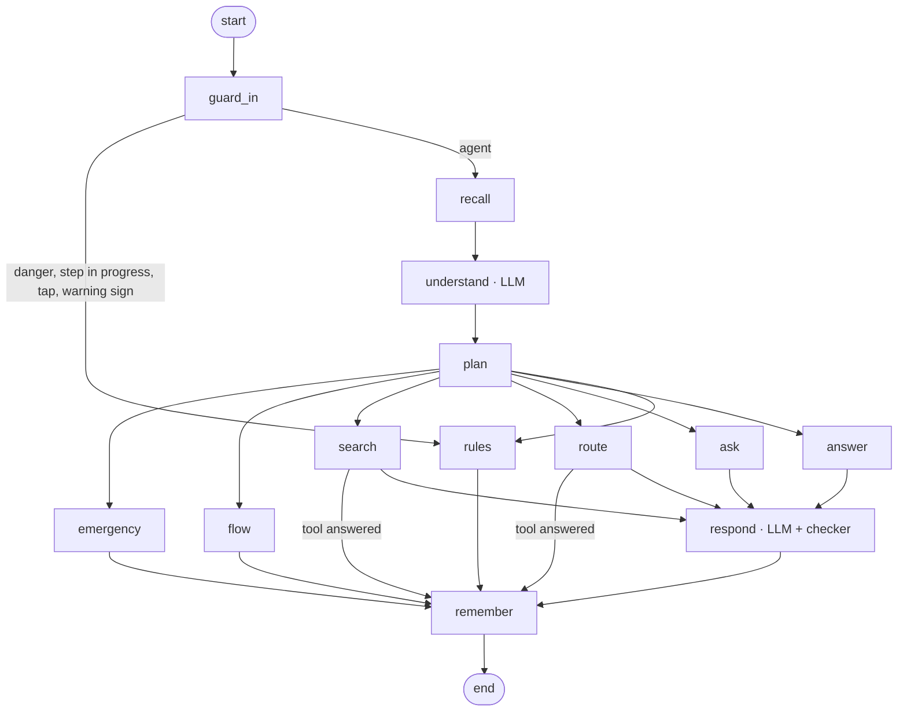

# Vita on LangGraph

`POST /v2/agent/chat` runs the whole conversation as one LangGraph graph (`hms_router/vita_graph/`). One graph run =
one patient message; the conversation's state is saved per session by a Redis checkpointer, so Vita remembers what was
said, survives restarts, and every turn can be inspected. Request and reply are unchanged (see
[vita_doctor_search.md](vita_doctor_search.md)); replies carry `engine`.

| Node | What it does | Model? |
|---|---|---|
| `guard_in` | Self-harm, the shared emergency detector, warning-sign situations (burn, head injury, pregnancy + swelling), steps in progress (booking/OTP, emergency follow-ups, "where are you?", "which doctor?"), visit/journey, Bangla, doctor taps, paging → `rules` | code |
| `rules` | Vita's tested rules engine (`DoctorChat`) answers | code |
| `recall` | The returning patient's memory; the 3 most similar approved examples | code |
| `understand` | Reads the message in the light of the conversation → `record_understanding`: intent, complaint so far in English, enough to choose a doctor?, danger signs, who / age group / pregnant, language, doctor filters | **LLM** |
| `plan` | Danger signs → emergency (the LLM can only add urgency); book / visit / person → flow; doctor filters → search; symptoms → route when enough (or after 2 questions), else ask; otherwise answer | code |
| `route` | `assess_symptoms`: emergency check on the LLM's reading + the patient's words, then the route-symptom engine (age group, pregnancy; a child's GP becomes a Paediatrician), then doctors from 1HMS | code (engine) |
| `search` | `find_doctors` with the filters (location question, nothing found, "which one?" answer themselves) | code |
| `flow` | Choosing, booking, availability, directions, check-in, token, handoff: the tested flow answers | code |
| `ask` / `answer` | Facts for one question (never one already answered) or a reply within Vita's role | code |
| `respond` | Writes the reply in the patient's language from the decision, facts, memory and examples → `reply` (+ ≤3 tap options); `checker.py` blocks medicines/doses, diagnoses, phone numbers, links, booking claims, unknown doctors, >700 chars → the tool's own words or the rules engine | **LLM** |
| `remember` | Appends the turn to the conversation, updates patient memory, writes the trace | code |

State that carries across turns: `messages`, `patient` (who, age group, pregnant, language), `triage` (complaint so
far, questions asked, routed), `stage`. Per-turn fields are reset at the start of each run.

## How Vita grows

| Signal | Where |
|---|---|
| Every turn traced: redacted message, understanding, decision, tools, checker result, reply, specialist | `vita:trace:{sid}`, `vita:conv:{sid}`, 30 days |
| Outcomes: booked, emergency, 👍/👎 from the patient | `POST /v2/agent/feedback {session_id, rating: up|down, comment?}` |
| Staff review: list conversations by outcome, open one turn by turn (with the saved graph state) | `GET /v2/agent/admin/conversations?outcome=booked|emergency|up|down`, `GET /v2/agent/admin/conversations/{sid}` |
| Staff approve a good turn, or correct its reply and/or its specialist → a **draft** example | `POST /v2/agent/admin/examples {session_id, turn, reply?, specialist?, note?}` (or `{patient, reply, specialist}`) |
| Tested before live: the scenario suite (`evals.py`: safety, routing, language, medicine, off-topic) runs with and without the drafts; drafts go live only if every safety scenario passes and the score is not lower | `POST /v2/agent/admin/examples/promote`; `python -m hms_router.vita_graph.evals` |
| Recall: active examples most like the message are shown to the LLM as "how Vita answered similar patients" | `ExampleStore.similar` (TF-IDF, character n-grams) |
| Patient memory (identified patients only: WhatsApp's verified number or a signed-in patient's token; key = HMAC of the mobile): language and city always; who they book for, past specialties and doctors only with `remember: true` (patient consent); 180 days | `vita:patient:{hmac}`; forget: `DELETE /v2/agent/patient-memory {patient_token | verified_mobile}` |
| Specialty learning stays in the route-symptom model (CMS-approved examples + `retrain.yml`) | `/admin/rebuild` |

## Control

`GET/PUT /v2/agent/admin/control` (scope `admin`): `{"mode": "agent" | "rules", "channels": {"whatsapp": "rules"}}`
— a kill switch, per channel. The agent also falls back to the rules engine with no `VITA_LLM_PROVIDER`, on any
error, and for 60 s after 3 failures in a row.

## Settings

`VITA_LLM_PROVIDER=groq` + `GROQ_API_KEY`, `VITA_LLM_MODEL` (default `openai/gpt-oss-120b`), `VITA_LLM_TIMEOUT`
(seconds per call, default 6). Two model calls per message (understand, respond). Patient text is redacted (phones,
emails, OTP-like numbers, "my name is ...") before it is sent. Checkpoints: `vita:ckpt:*`, 40 per conversation, 7 days.

## Tests

`tests/test_vita_graph.py`: a scripted model stands in for Groq (each step is an understanding or a reply tool call),
covering every node, the checker, the breaker, the control switch, restarts, memory with and without consent,
feedback → review → correction → recall, and the promotion gate.
